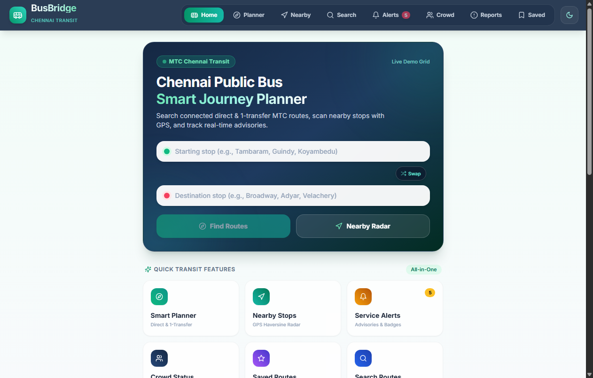
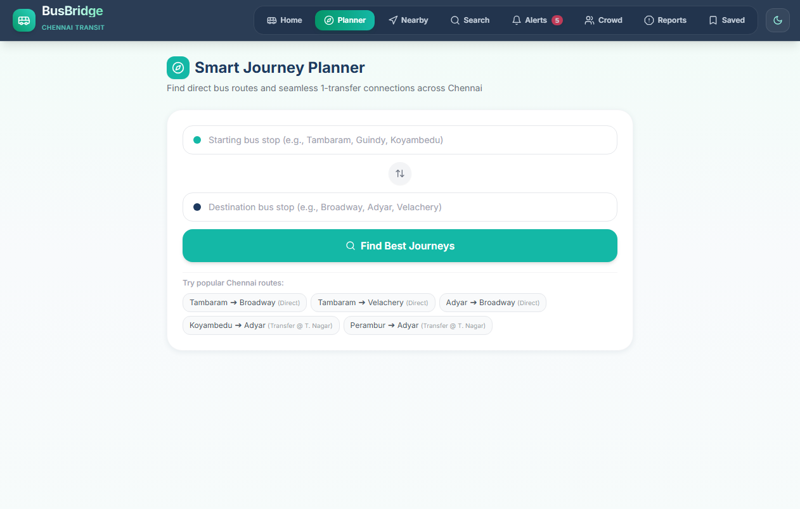
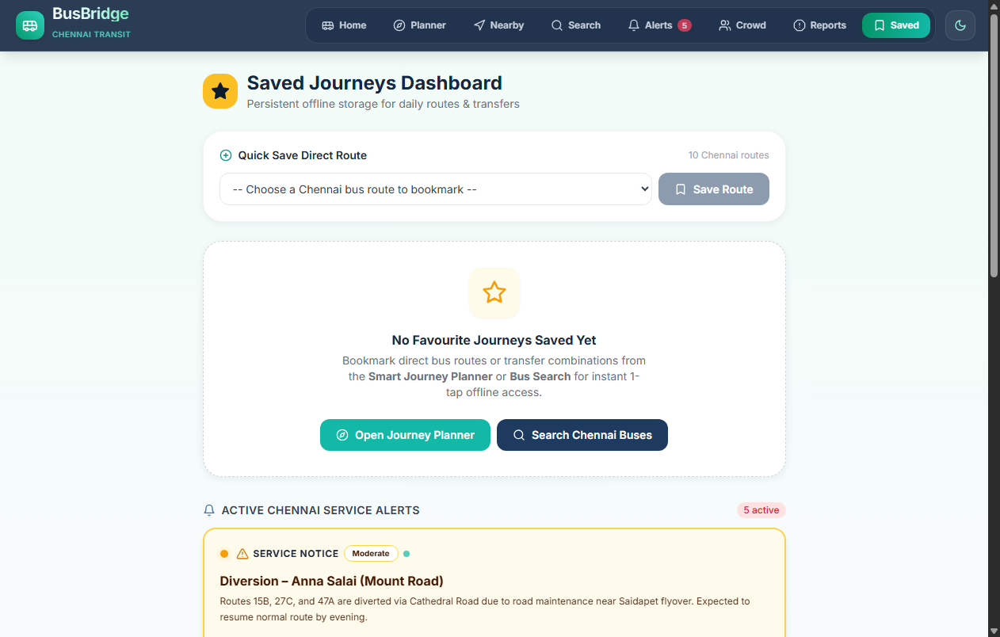
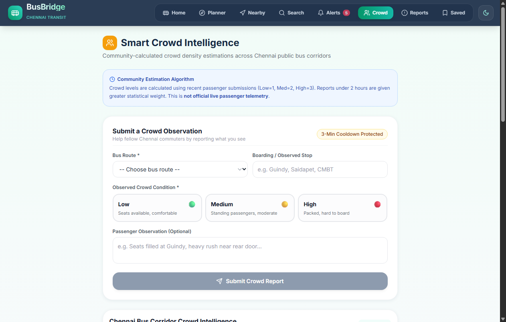
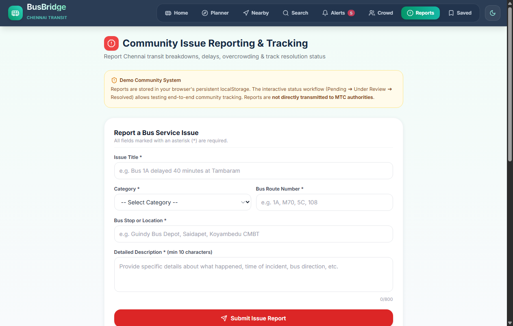
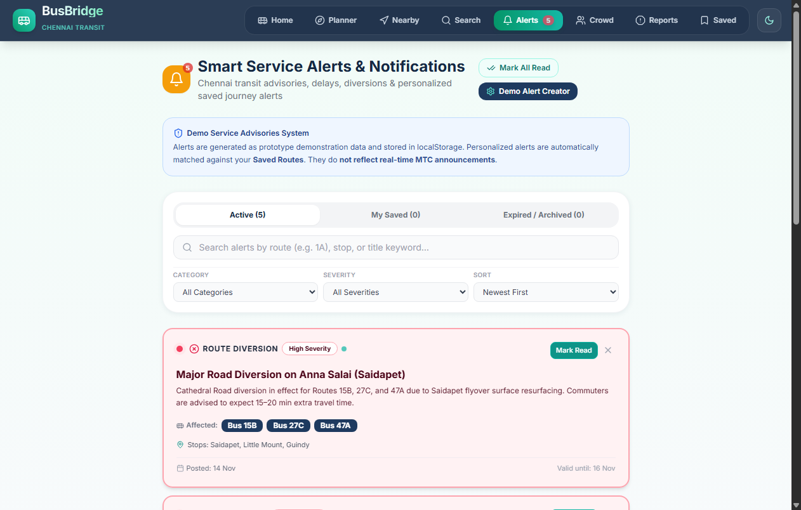
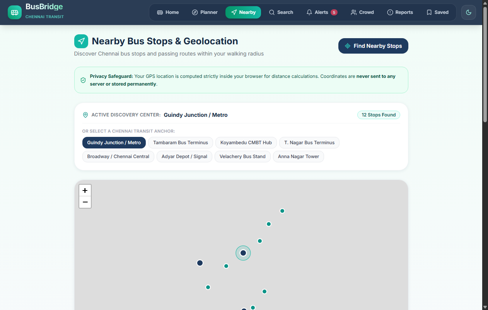
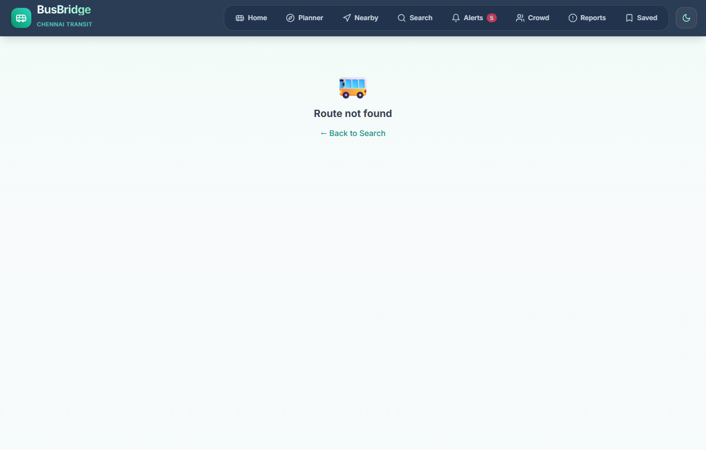

# 🚌 BusBridge – Chennai Public Bus Transit Hub

[](https://vitejs.dev/)
[](https://react.dev/)
[](https://tailwindcss.com/)
[](https://leafletjs.com/)
[](https://github.com/Naveenkumar2007cit/SWYNEX-App-Development-Internship)

**BusBridge** is a modern, responsive public transit web application designed to solve transit information gaps for commuters across the Chennai Metropolitan Transport Corporation (MTC) network.

Developed as the **Final App Project (Task 4)** for the **SWYNEX Technologies App Development Internship**.

---

## 📌 Problem Statement

Commuters navigating urban public bus transit in Chennai frequently encounter critical challenges:
- **Unclear Route Connections:** Difficulties identifying connecting routes when direct buses are unavailable.
- **Information Asymmetry:** Lack of clarity regarding boarding points, intermediate stops, and transfer hubs.
- **Sudden Service Changes:** Unannounced route diversions, road closures, or cancellations without proactive user notifications.
- **Unpredictable Crowd Levels:** Boarding overcrowded buses without prior awareness.
- **Fragmented Access:** Frequent commuters must repeatedly re-enter search queries for daily transit corridors.

---

## 🎯 Project Objectives

1. **Intelligent Transit Connection:** Provide an intelligent journey planner supporting both direct routes and 1-transfer connections across major Chennai hubs.
2. **Persistent Favourites (Core Feature Path):** Deliver a resilient offline-first Saved Routes engine with duplicate validation, storage sanitization, and instant state reactivity.
3. **Hyperlocal Radar (Haversine Formula):** Enable instant discovery of nearby bus stops within configurable radii (500m to 10km) using browser geolocation and mathematical spherical distances.
4. **Proactive Transit Advisories:** Alert passengers to road diversions, delays, and cancellations with personalized notifications linked to their saved journeys.
5. **Community-Powered Intelligence:** Aggregate crowd occupancy estimates and grievance reports with spam prevention and tracking.

---

## 🚀 Progress Across Internship Tasks

| Phase | Milestone | Deliverables | Status |
|---|---|---|---|
| **Task 1** | App Concept & Screen Flow | Problem statement, user personas, UI wireframes, screen flow architecture (`Design/`, `Flowchart/`, `Documentation/`) | ✅ Completed |
| **Task 2** | Core Application & Routing | React + Vite setup, Tailwind CSS styling, bus search engine, stop lists, and interactive Leaflet map view | ✅ Completed |
| **Task 3** | App Features & State Management | Persistent Saved Routes, Smart Journey Planner, Nearby Stops Geolocation, Service Alerts Center, Community Crowd Reporting | ✅ Completed |
| **Task 4** | Final App Project & Polish | Production audit, zero-error build, real running screenshots (1-9), complete documentation, demo guide, dark mode | ✅ Completed |

---

## ✨ Features Actually Implemented

### 1. Persistent Saved Routes (Core Feature Path)
- **Offline-First Persistence:** Stored reliably in `localStorage` (`busbridge_saved_routes`) with corrupted data recovery and zero-backend dependency.
- **Input & Route Validation:** Comprehensive checks ensuring valid sources, destinations, and bus details.
- **Identical Stop Prevention:** Rejects journeys where starting stop and destination are identical.
- **Duplicate Prevention:** Matches candidate source, destination, and bus sequence; displays a clear warning toast if already saved.
- **Complete Dashboard (`/saved`):** Search saved journeys, filter by Direct vs Transfer, and sort by Recent, Duration, or Stops.
- **Safe Management:** 1-tap individual removal, plus confirmed modal for clearing all journeys.

### 2. Smart Journey Planner (`/planner`)
- Direct and 1-transfer connectivity across 40+ Chennai stops (Tambaram, Guindy, Koyambedu CMBT, Broadway, Adyar, Velachery, Saidapet, etc.).
- Sort results by **Fastest Route**, **Fewest Transfers**, and **Shortest Distance**.
- Interactive stop-by-stop visual timeline showing boarding, interchange, and arrival stops.
- 1-tap **"Save Route"** directly from journey result cards.

### 3. Nearby Bus Stops & Haversine Geolocation Radar (`/nearby`)
- Privacy-first Geolocation: GPS coordinates are accessed only upon explicit user request and processed strictly in-browser.
- Distance calculated via standard **Haversine formula** and formatted dynamically (`350 m` or `1.86 km`).
- Interactive Leaflet map with pulsing user beacon and color-coded stop pins.
- 8 Chennai Transit Anchors fallback for testing without GPS.

### 4. Smart Service Alerts & Notification Center (`/alerts`)
- Categorized transit advisories: Delays, Diversions, Disruptions, Stop Changes, Cancellations, Advisories.
- **Personalized Route Alerts:** Highlights active notices with a gold **"Affects Your Saved Journey"** badge.
- Real-time unread notification count badge in top navbar and mobile bottom nav.
- Demo/Admin alert publication simulator.

### 5. Community Crowd Intelligence & Grievance Reporting (`/crowd`, `/report`)
- Community-based crowd calculation (Low = 1, Medium = 2, High = 3) with abuse cooldown limits.
- Issue reporting system generating unique ticket tracking references.

### 6. Design System & Theme Engine
- **"Chennai Emerald Glassmorphism"** theme with MTC Emerald accents, frosted glass panels, and ambient glows.
- **Light & Metro Dark Mode** toggle in the top navbar with persistent `localStorage` preference.
- Full mobile thumb-zone layout with responsive bottom navigation and a floating **Nearby Radar FAB**.

---

## 📸 Screenshots (Captured from Running Production Application)

| 1. Dashboard | 2. Journey Planner |
|:---:|:---:|
|  |  |

| 3. Journey Results | 4. Saved Routes |
|:---:|:---:|
|  |  |

| 5. Crowd Intelligence | 6. Issue Reporting |
|:---:|:---:|
|  |  |

| 7. Service Alerts | 8. Nearby Stops |
|:---:|:---:|
|  |  |

| 9. Interactive Map |
|:---:|
|  |

*Full documentation for every capture is available in [`screenshots/README.md`](screenshots/README.md).*

---

## 🛠️ Technology Stack

| Layer | Tools |
|---|---|
| **Frontend Framework** | React 18.3.1 |
| **Build Tool** | Vite 5.4.10 (Rollup manual chunking) |
| **Routing** | React Router DOM 6.28.0 (Code-split with `React.lazy`) |
| **Styling** | Tailwind CSS 3.4.14 (with custom `mtc` color tokens & `darkMode: 'class'`) |
| **Mapping & Geospatial** | Leaflet 1.9.4 & React-Leaflet 4.2.1 |
| **Iconography** | Lucide React 0.453.0 |
| **Storage Architecture** | Synchronous `localStorage` with error handling & custom DOM events |

---

## 📁 Repository Structure

```text
├── busbridge/                   # React + Vite application root
│   ├── index.html               # Entry HTML with preloaded Inter font
│   ├── vite.config.js           # Chunk configuration for Leaflet & icons
│   ├── tailwind.config.js       # Color tokens, MTC theme & dark mode
│   ├── package.json             # Dependencies and scripts
│   └── src/
│       ├── App.jsx              # Code-split router & theme provider
│       ├── components/          # Reusable UI components (Navbar, AlertCard, MapView)
│       ├── data/                # Chennai transit stops, coordinates & demo alerts
│       ├── hooks/               # Custom React hooks (useSavedRoutes)
│       ├── pages/               # Application route views (Home, Planner, Nearby, Saved)
│       └── services/            # Storage, Haversine, route search, and alert engines
├── Design/                      # UI design wireframes & screen captures from Task 1
├── Documentation/               # Comprehensive technical documentation
│   ├── DEMO.md                  # Complete 5-minute evaluation demonstration guide
│   ├── FEATURES.md              # Detailed feature audit and status matrix
│   ├── TECH_STACK.md            # Architectural breakdown & algorithms
│   └── SETUP_GUIDE.md           # Local setup and execution manual
├── Flowchart/                   # Application journey workflows
├── screenshots/                 # 9 actual production screenshots & gallery guide
└── README.md                    # Project documentation
```

---

## ⚙️ Installation & How to Run Locally

### 1. Prerequisites
- [Node.js](https://nodejs.org/) (v18.0.0 or higher)
- [npm](https://www.npmjs.com/) (v9.0.0 or higher)

### 2. Setup Commands
```bash
# Clone the repository
git clone https://github.com/Naveenkumar2007cit/SWYNEX-App-Development-Internship.git

# Navigate into the busbridge project directory
cd SWYNEX-App-Development-Internship/busbridge

# Install dependencies
npm install

# Start the Vite local development server
npm run dev
```

Open **`http://localhost:5173`** in your browser.

### 3. Production Build & Preview
```bash
npm run build
npm run preview
```

---

## 💾 Data Storage & State Architecture

BusBridge uses a resilient, offline-first client-side architecture powered by browser `localStorage`:
- `busbridge_saved_routes`: Array of user-saved direct & transfer journeys with timestamps.
- `busbridge_service_alerts`: Active and archived transit notices.
- `busbridge_read_notifications`: Set of notification IDs marked as read.
- `busbridge_crowd_reports`: Crowd reports with rate-limiting timestamp cooldowns.
- `busbridge_reported_issues`: Passenger grievance history and ticket statuses.
- `busbridge_recent_searches`: Recent search pairs for 1-tap replay.
- `busbridge_theme`: Persistent visual mode selection (`"light"` or `"dark"`).

Cross-component updates are synchronized reactively via custom DOM events (`busbridge_saved_routes_changed` and `busbridge_notifications_changed`).

---

## 🧪 Testing & Verification

1. **Automated Test Suite:** Evaluated storage validation, duplicate prevention, item deletion, and clear-all operations using an automated headless runner.
2. **Production Build:** Vite production build compiles 1651 modules with 0 errors in ~5.40s.
3. **Cross-Device Testing:** Verified on mobile (360px), tablet (768px), and desktop (1280px+) viewport breakpoints.
4. **Demonstration Guide:** Step-by-step instructions available in [`Documentation/DEMO.md`](Documentation/DEMO.md).

---

## ⚠️ Known Limitations

1. **Demo Transit Data:** Stop coordinates, route connectivity, and schedules are modeled after verified Chennai MTC corridors (Anna Salai, GST Road, OMR, Poonamallee High Road). Live GPS tracking of actual buses is simulated for evaluation purposes.
2. **Community Crowd Estimation:** Crowd levels are calculated mathematically from client-stored reports and should not be construed as official MTC telemetry.
3. **Data Scope:** The demo network encompasses major Chennai hubs. Outlying or rural routes beyond the metropolitan corridor are currently excluded.

---

## 🔮 Future Enhancements

1. **PWA Offline Service Worker:** Cache static assets and OpenStreetMap tiles for full offline functionality.
2. **Direct MTC Open Data Integration:** Connect to official Chennai transit APIs when public telemetry becomes available.
3. **Voice Transit Search:** Tamil and English speech recognition for bus stops.
4. **Native Android Package (APK):** Export using Capacitor/Cordova for distribution on Google Play Store.

---

## 👤 Author & Acknowledgements

- **Developer:** Naveen Kumar S
- **Internship:** SWYNEX Technologies App Development Internship (Task 4 – Final App Project)
- **Repository:** [Naveenkumar2007cit/SWYNEX-App-Development-Internship](https://github.com/Naveenkumar2007cit/SWYNEX-App-Development-Internship)
