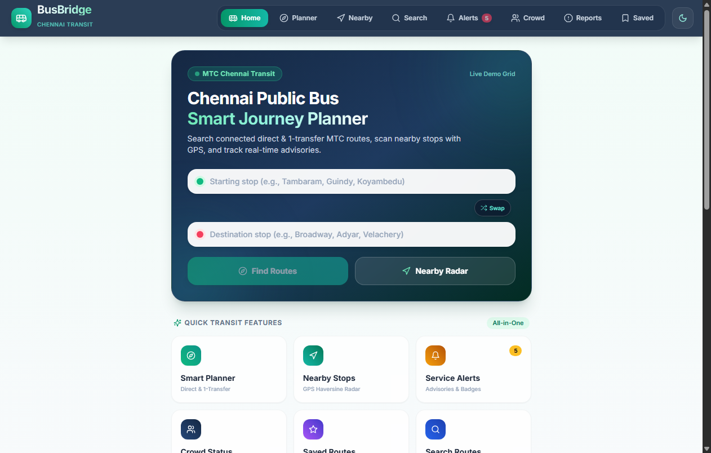
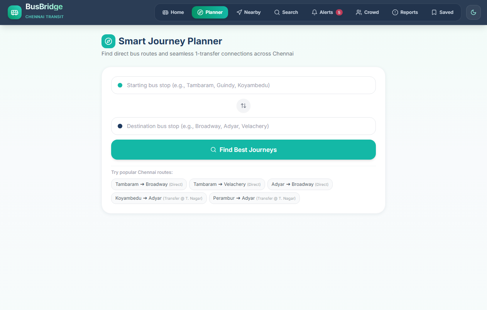
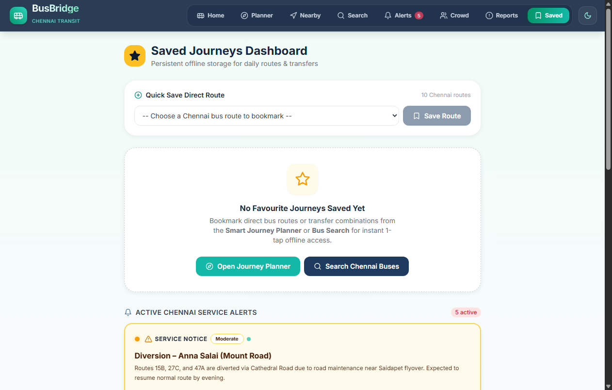
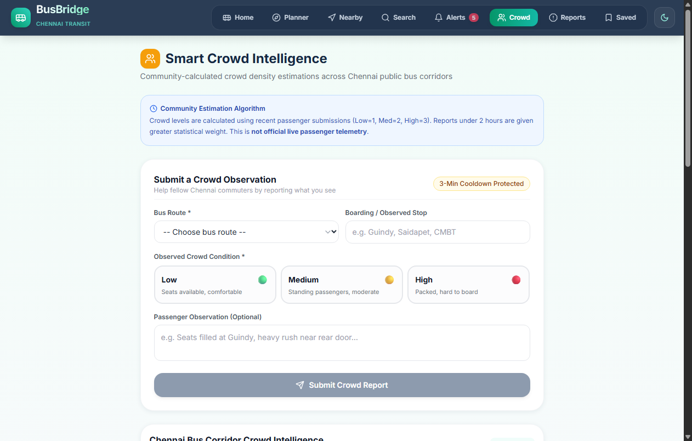
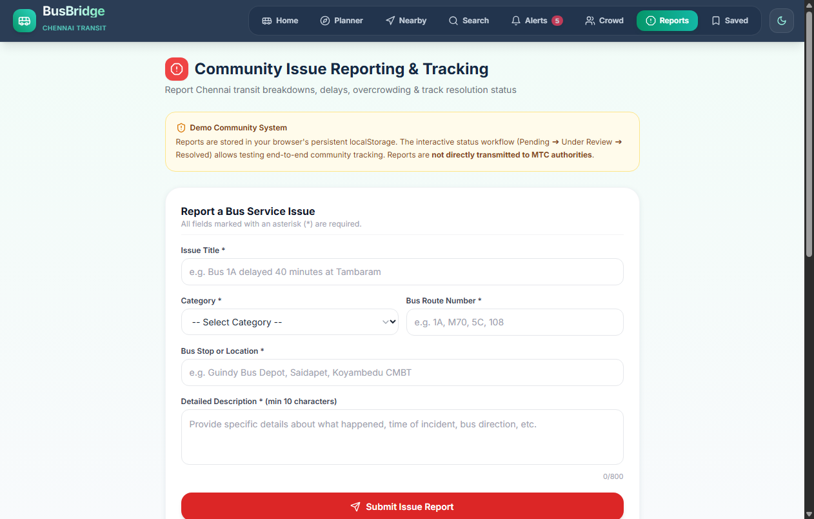
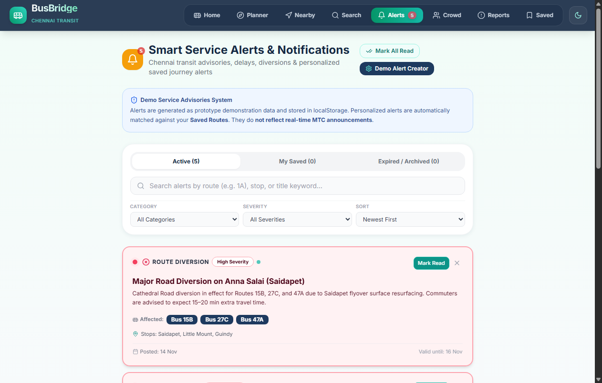
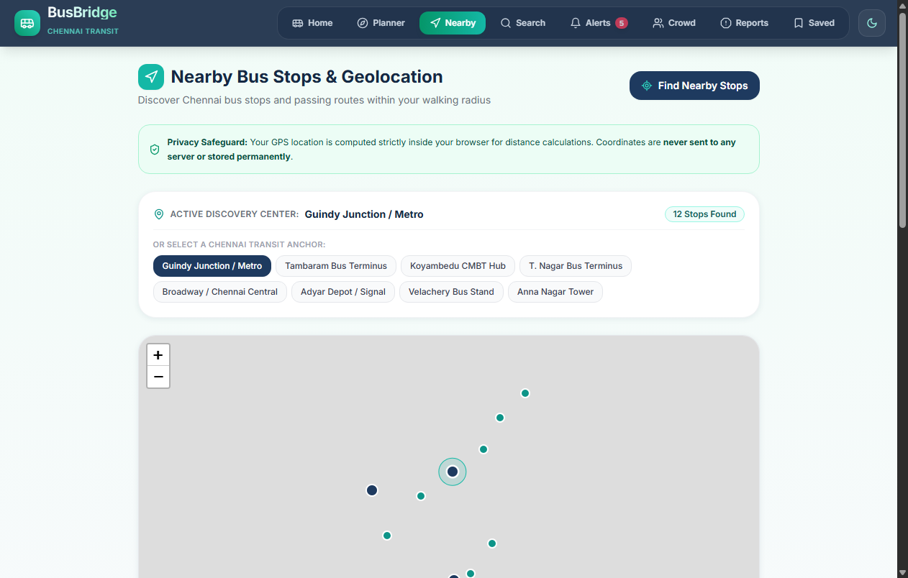
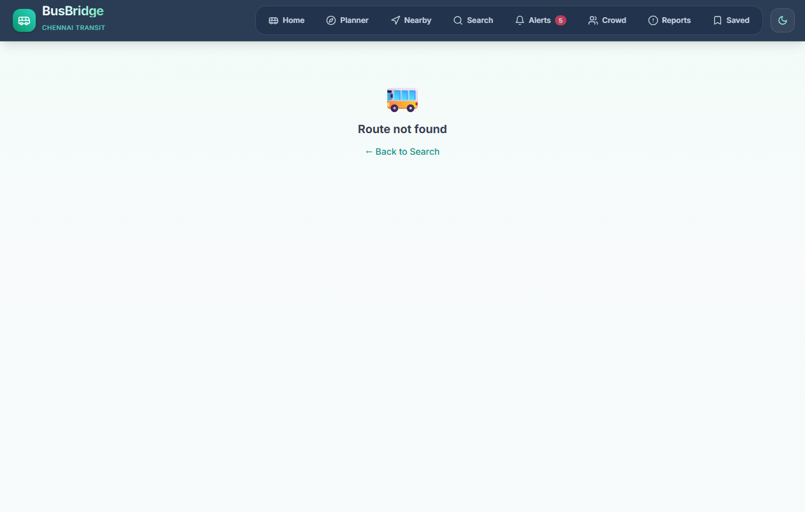

# BusBridge – Live Application Screenshots

This directory contains **actual screenshots captured directly from the running production preview build** of the BusBridge application for the **SWYNEX Technologies App Development Internship – Task 4 Final Deliverable**.

All 9 screenshots were captured on 1280x900 viewport under standard desktop aspect ratio, demonstrating working pages, interactive states, and theme elements.

---

## Screenshot Gallery & Details

### 1. Home Dashboard (`01_dashboard.png`)

- **Path:** `/`
- **Features shown:** "Chennai Emerald Glassmorphism" hero banner with MTC transit badge, predictive autocompletes for Chennai bus stops, direction swap button (`Shuffle`), quick transit features launchpad with live counter badges, nearby stops preview, and active service advisories banner.

---

### 2. Smart Journey Planner (`02_journey_planner.png`)

- **Path:** `/planner`
- **Features shown:** Source and destination search inputs with auto-suggestions, direction swap, and multi-leg search triggers.

---

### 3. Journey Results & Multi-Leg Connections (`03_journey_results.png`)

- **Path:** `/planner?source=Tambaram&destination=Broadway`
- **Features shown:** Direct bus routes and 1-transfer connections across Chennai hubs (e.g. connecting via Guindy), sorting toggles (*Fastest Route*, *Fewest Transfers*, *Shortest Distance*), stop-by-stop journey breakdown, and 1-tap **"Save Route"** action button.

---

### 4. Saved Routes & Persistent State (`04_saved_routes.png`)

- **Path:** `/saved`
- **Features shown:** Task 3 & 4 core feature dashboard showing persistent saved routes in `localStorage`, route type filters (*All*, *Direct Routes*, *1-Transfer*), sorting by *Recent* or *Duration*, individual deletion button, and confirmed *Clear All* modal trigger.

---

### 5. Community Crowd Intelligence (`05_crowd_intelligence.png`)

- **Path:** `/crowd`
- **Features shown:** Community-sourced occupancy level ratings (Low, Medium, High), confidence score indicator, last reported timestamp, submission form with cooldown abuse protection, and transparency notice labeling data as community estimation.

---

### 6. Passenger Grievance & Issue Reporting (`06_issue_reporting.png`)

- **Path:** `/report`
- **Features shown:** Multi-category issue submission (punctuality, ticketing, vehicle hygiene), generated unique reference tracking ID, and local grievance history tracker.

---

### 7. Smart Service Alerts & Notification Center (`07_service_alerts.png`)

- **Path:** `/alerts`
- **Features shown:** Categorized transit advisories (delays, diversions, disruptions, cancellations), distinct severity tags with pulsating status beacons, *My Saved* personalized tab with gold **"Affects Your Saved Journey"** badges, mark read/unread toggles, and demo alert publisher.

---

### 8. Nearby Bus Stops & Haversine Radar (`08_nearby_stops.png`)

- **Path:** `/nearby`
- **Features shown:** Privacy-first GPS trigger, standard Haversine formula calculation (displaying exact distances e.g. `350 m` or `1.86 km`), configurable search radius (500m to 10km), 8 curated Chennai Transit Anchors fallback, and 1-tap "Plan Trip →" buttons.

---

### 9. Interactive Map View (`09_interactive_map.png`)

- **Path:** `/route/1`
- **Features shown:** Interactive Leaflet transit map, custom stop marker pins, route polyline path across Chennai corridors, and stop sequence timeline.

---

*Wireframes and initial UI concepts from Task 1 are additionally preserved in the root `Design/` directory.*
